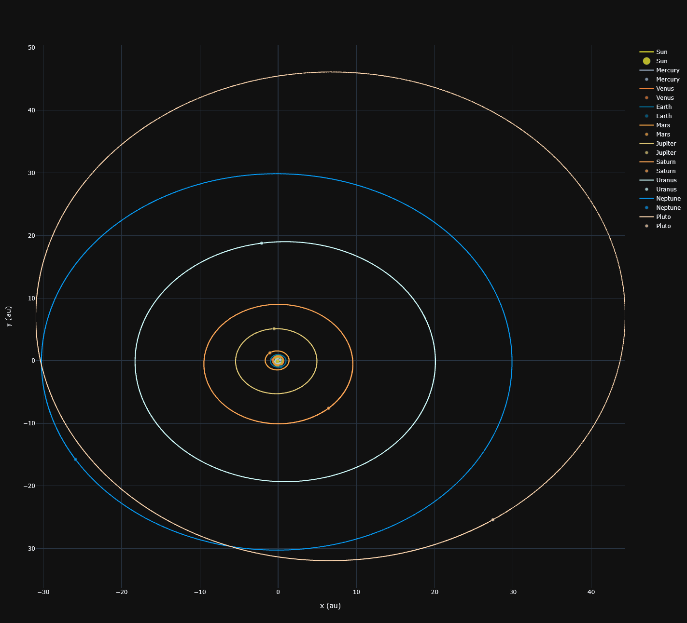
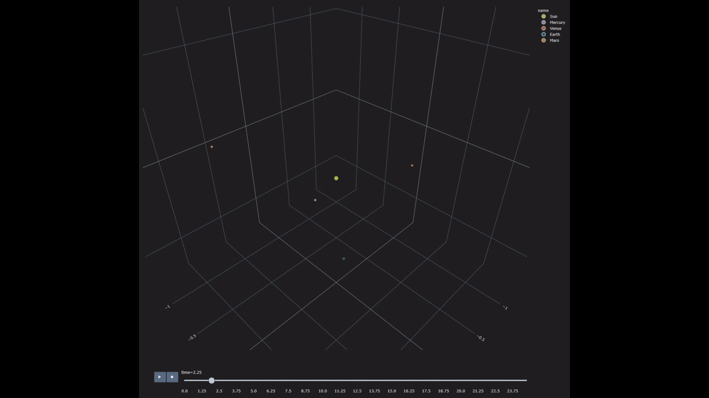

# solarsystem
Numerical simulation of the solar system

## Example output

The simulation produces a 2D view of the planetary orbits and an animated 3D view:

## Usage

1. Create a conda environment with all the required packages using the following commands:

       conda env create --file environment.yml
       conda activate solarsystem

2. Add your paths:
   * Rename `.env.sample` file to `.env`
   * Within the new file, replace the dummy path with your local path to export the graphics

3. Make sure the PYTHONPATH environment variable is set to your working directory, which should be the
'solarsystem' folder:
    Windows:

        set "PYTHONPATH=C:\yourpathtofolder\solarsystem"

   Linux:

        export PYTHONPATH=${PYTHONPATH}:${HOME}/yourpathtofolder/solarsystem

4. Execute the main file

       python scripts/main.py
